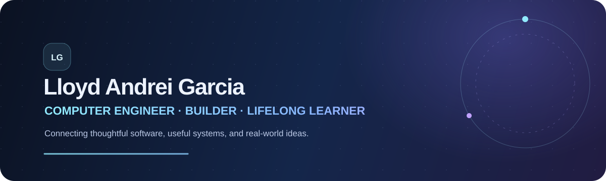

  

   

  
  

    

  <samp>MOBILE APPS · RESPONSIVE WEB · WORKFLOW TOOLS</samp>

---

## I build useful digital experiences for real-world needs.

I’m Lloyd Andrei Garcia, a Computer Engineering student focused on **Flutter
mobile apps, responsive websites, and practical business tools**. I care about
making software clear to use, dependable, and grounded in the problem it is
meant to solve.

If you have an idea, I can help shape it into a considered interface and a
working implementation—from the first user flow to the details that make it
feel polished.

### How I can help

- **Mobile apps:** Flutter interfaces and features designed around real user flows.
- **Web experiences:** responsive portfolio, product, and landing pages.
- **Workflow tools:** clear dashboards and interfaces for everyday operations.

### Featured work

- **[IskolarHub](https://github.com/andreiigop/Iskolarhub)** — A Flutter app
  concept for helping students discover scholarship opportunities and keep
  their application journey organized.
- **[InventaRise](https://andreiigop.github.io/inventarise/#projects)** — An
  inventory and operations dashboard showcase for stock, deliveries, and
  reporting workflows. Demo figures are sample data.
- **[Portfolio](https://andreiigop.github.io/inventarise/)** — Interactive
  project previews and more of my work.

### What you can expect

- A focus on your users and the goal behind the project.
- Clear communication and thoughtful, practical design choices.
- Careful implementation, testing, and refinement.

### ⚙️ My current toolkit

  
  
  
  
  
  
  

---

  <h3>Have a project in mind?</h3>
  
Send me the goal, who it is for, and what you need help with.

  <a href="mailto:lloydgarcia0923320623@gmail.com?subject=Project%20inquiry">Email me about your project ↗</a>

